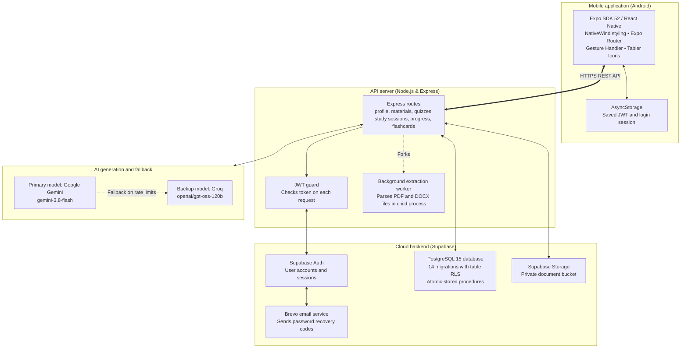
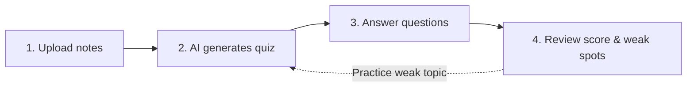
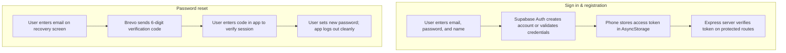
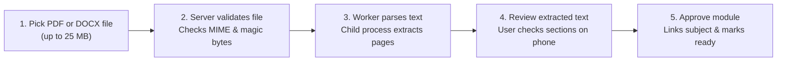
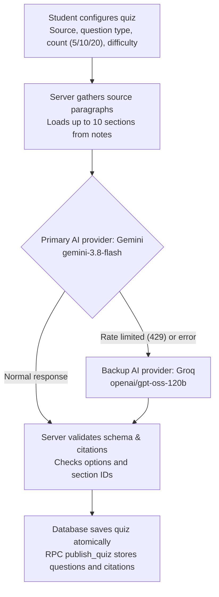
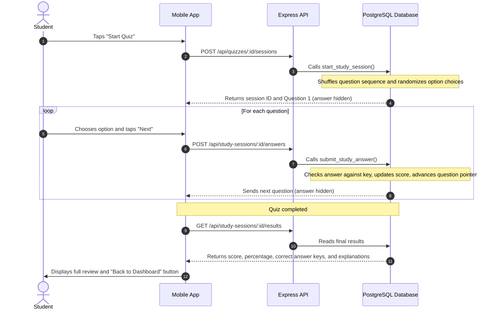
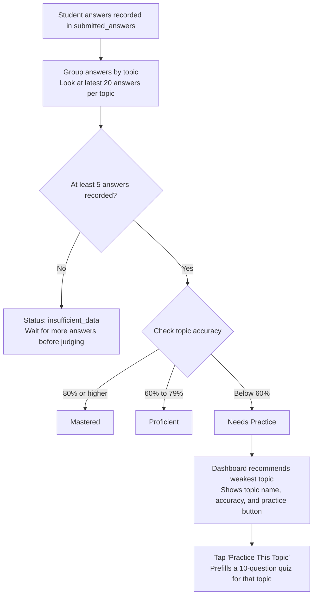
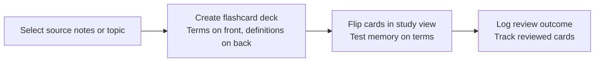
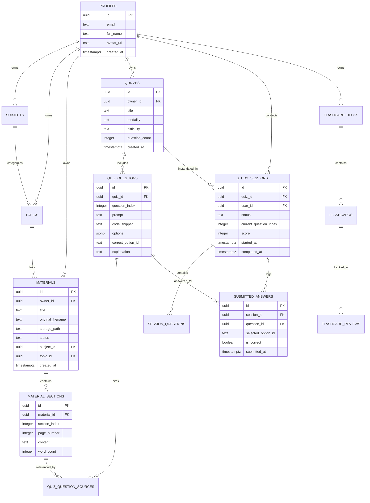

# RebyuIT system overview and technical architecture

RebyuIT is an exam review application for Bachelor of Science in Information Technology (BSIT) students and faculty at Pangasinan State University, Asingan Campus. It generates practice quizzes from course syllabi and lecture slides, scores answers on the server, and tracks student progress across topics.

Students often prepare for examinations using scattered lecture handouts and static notes that do not identify specific knowledge gaps or adapt to individual performance. RebyuIT addresses this by:

- Extracting text from uploaded PDF and DOCX course notes inside an isolated worker process.
- Generating multiple-choice, true/false, and coding syntax questions with source citations using Google Gemini, with automated failover to Groq.
- Keeping answer keys on the server during active sessions to prevent client-side inspection.
- Calculating rolling topic mastery from the last 20 answers per topic and suggesting weak areas on the dashboard.

## System architecture

The application has three layers: a mobile client, an API server, and a cloud backend for data, files, and authentication.

## How the system works (core workflows)

The system runs on a 4-step loop: upload notes, generate questions, take quizzes with server-side grading, and practice recommended weak topics.

---

### Workflow 1: Account setup and password recovery

Student and faculty accounts are private. Row-level security in PostgreSQL ensures users can only access their own materials, quizzes, and session history.

* **What you see on your phone**: You sign in with your email and password. If you forget your password, you request a 6-digit code sent to your email, type the code into the app, and enter a new password.
* **Behind the scenes**: Supabase Auth issues JSON Web Tokens (JWTs). The mobile app stores the token in `AsyncStorage` when "Remember Me" is enabled. When making API calls, the app passes this token in the `Authorization: Bearer` header. The server verifies the token with Supabase and attaches your user ID to the request.

---

### Workflow 2: Uploading notes and extracting text

To prevent large or malformed files from slowing down the server or crashing the process, file parsing runs inside an isolated worker child process.

* **What you see on your phone**: 
  1. You pick a lecture syllabus or notes file (PDF or DOCX, up to 25 MB) and tap upload.
  2. You open the uploaded file preview, read the extracted text chunks, pick your BSIT subject (like *Networking* or *Database Systems*), and tap **Approve**.
* **Behind the scenes**: 
  1. `materialValidation.js` reads the file header (magic bytes: `%PDF-` for PDFs, `PK\x03\x04` for DOCX) to ensure the file is legitimate.
  2. The file is uploaded to a private Supabase Storage bucket (`materials/{ownerId}/{materialId}/raw`).
  3. `materialExtractionWorker.js` runs in a separate Node.js child process with memory caps and a timeout. It extracts text and saves page numbers and word counts into `material_sections`.
  4. When you tap Approve, the server runs the `approve_material` database procedure, linking your chosen subject and setting the document status to `ready`.

---

### Workflow 3: Generating quizzes with AI citations

Quizzes are created from either approved notes or general BSIT curriculum topics. Questions always include citations pointing back to the source notes to prevent the AI from inventing facts.

* **What you see on your phone**: You select a source (your approved notes or an IT curriculum topic), question type (Multiple Choice, True/False, or Coding Syntax), question count (5, 10, or 20), and difficulty. After a few seconds, your quiz is ready.
* **Behind the scenes**:
  1. `quizService.js` loads up to 10 text sections from your notes.
  2. It sends these sections to Google Gemini with strict JSON formatting instructions. Every question must reference the ID of the section where the answer was found.
  3. If Gemini is busy or hits rate limits, the request automatically reroutes to Groq so the generation does not fail.
  4. `quizValidation.js` checks that every question has distinct choices, valid answer keys, and existing citation IDs.
  5. The database procedure `publish_quiz` inserts the quiz, its questions, and its citations in one atomic transaction.

---

### Workflow 4: Taking quizzes with anti-cheat protection

Answer keys and explanations are omitted from the active quiz session so answers cannot be inspected over the network. The server grades each response only when submitted.

* **What you see on your phone**: 
  1. Questions appear one at a time with shuffled options.
  2. You pick an option and tap **Next**. Correct answers are not revealed during the test.
  3. When you answer the final question, the screen immediately shows your final score, percentage, full explanations, and the exact paragraphs from your notes that support each answer.
* **Behind the scenes**: 
  1. When starting, the server runs `start_study_session`, which randomizes question positions and option orders (e.g. `['c', 'a', 'd', 'b']`).
  2. The endpoint `getSafeQuestion` strips `correct_option_id` and `explanation` from the payload before sending it to your phone.
  3. When you tap Next, `submit_study_answer` records your answer in `submitted_answers`, computes correctness on the server, updates your streak, and advances to the next question.

---

### Workflow 5: Spotting weak topics and suggesting practice

The app monitors student progress across curriculum topics and highlights areas that need more attention.

* **What you see on your phone**: 
  - Your dashboard shows your overall score, current study streak, and topic mastery levels.
  - If you score poorly on a topic (like *Object-Oriented Programming*), a yellow alert card appears:  
    `0% Accuracy • 5 questions • Needs Practice`  
    `Object-Oriented Programming`  
    `[ Practice This Topic ➔ ]`
  - Tapping **Practice This Topic** opens the quiz generator with that topic pre-selected, so you can practice right away.
* **Behind the scenes**:
  1. `progressEstimates.js` takes up to the latest 20 answers for each topic. Older mistakes drop off as you improve.
  2. Topics need at least 5 answers before receiving a rating to avoid making premature recommendations.
  3. `topicRecommendations.js` finds topics with accuracy below 70%, sorts them from lowest to highest, and displays the weakest area at the top of your dashboard.

---

### Workflow 6: Studying flashcards

Students can create flashcard decks from their notes or topics for rapid review before exams.

* **What you see on your phone**: You open a flashcard deck, read a term on the front of a card, tap to flip it and check the definition, and mark whether you remembered it.
* **Behind the scenes**: `flashcardRoutes.js` handles creating decks, fetching cards, and recording review history in `flashcard_reviews` to track retention over time.

---

## Database schema

The database runs on PostgreSQL 15 via Supabase across 14 schema migrations. Every table includes row-level security policies scoped to `auth.uid()`.

### Key stored procedures

- `approve_material(material_id, subject_id, topic_id)`: Checks ownership, associates curriculum labels, and changes material status to `ready`.
- `publish_quiz(quiz_payload)`: Inserts quiz records, questions, and section citations in a single transaction.
- `start_study_session(quiz_id, user_id)`: Creates a session record, shuffles questions, and randomizes option display order.
- `submit_study_answer(session_id, question_id, selected_option)`: Evaluates the answer against the stored key, updates streaks and score counts, and advances the session pointer.

## API endpoints

The Express application registers 25 endpoints under `/api` in [server/src/app.js](file:///C:/ai-reviewer-app/server/src/app.js):

| Group | Method and URL | Controller | Access | Purpose |
| :--- | :--- | :--- | :--- | :--- |
| Health | `GET /health` | Inline | Public | Liveness check returning `{"status":"ok"}` |
| Profile | `GET /api/profile` | `profileController.js` | Protected | Reads authenticated user profile and program data |
| Materials | `POST /api/materials` | `materialController.js` | Protected | Uploads and starts extraction on a course document |
| Materials | `GET /api/materials` | `materialController.js` | Protected | Lists user's uploaded materials |
| Materials | `GET /api/materials/:id` | `materialController.js` | Protected | Fetches extracted section preview |
| Materials | `POST /api/materials/:id/approve` | `materialController.js` | Protected | Links subject label and marks document ready |
| Materials | `DELETE /api/materials/:id` | `materialController.js` | Protected | Deletes document, sections, and storage file |
| Quizzes | `POST /api/quizzes/generations` | `quizController.js` | Protected | Starts background quiz generation job |
| Quizzes | `GET /api/quizzes/generations/:id` | `quizController.js` | Protected | Checks status of an ongoing generation |
| Quizzes | `GET /api/quizzes` | `quizController.js` | Protected | Lists user's generated quizzes |
| Quizzes | `POST /api/quizzes/:id/sessions` | `quizController.js` | Protected | Starts a new study session from a quiz |
| Sessions | `GET /api/study-sessions/:id/question` | `quizController.js` | Protected | Reads current question without answer keys |
| Sessions | `POST /api/study-sessions/:id/answers` | `quizController.js` | Protected | Submits student answer for atomic evaluation |
| Sessions | `GET /api/study-sessions/:id/results` | `quizController.js` | Protected | Fetches final score, answer keys, and explanations |
| Progress | `GET /api/progress/recommendations` | `progressController.js` | Protected | Fetches weak-topic suggestions for dashboard |
| Progress | `GET /api/progress/estimates` | `progressController.js` | Protected | Reads topic mastery percentages |
| Progress | `GET /api/progress/streak` | `progressController.js` | Protected | Reads current study streak count |
| Progress | `GET /api/progress/report` | `progressController.js` | Protected | Reads comprehensive performance breakdown |
| Flashcards | `GET /api/flashcards` | `flashcardController.js` | Protected | Lists user's flashcard decks |
| Flashcards | `POST /api/flashcards` | `flashcardController.js` | Protected | Creates flashcard deck from topic or document |
| Flashcards | `GET /api/flashcards/:id` | `flashcardController.js` | Protected | Reads cards in a deck |
| Flashcards | `POST /api/flashcards/:id/reviews` | `flashcardController.js` | Protected | Logs front/back study review outcomes |
| Flashcards | `DELETE /api/flashcards/:id` | `flashcardController.js` | Protected | Removes deck and associated cards |
| Labels | `GET /api/profile/labels` | `labelController.js` | Protected | Fetches BSIT subject and custom topic labels |
| Labels | `POST /api/profile/labels/topics` | `labelController.js` | Protected | Adds a custom topic label under a subject |

## Engineering invariants

1. **Subprocess isolation**: Binary files (PDF, DOCX) are parsed inside `materialExtractionWorker.js` with memory caps and timeout signals. The main Express event loop never runs binary parsers directly.
2. **Hidden answer keys**: While a session is active, endpoints return only question text, code snippets, and shuffled option IDs. Correct answers and explanations are held on the server until the quiz is completed.
3. **Provider failover**: If Gemini returns rate limit errors (HTTP 429) or upstream outages, the server retries immediately with Groq before returning an error to the user.
4. **Idempotency**: Generation requests and answer submissions accept client-provided request IDs to avoid duplicate billing or repeated scoring on network retries.
5. **Row-level isolation**: Database queries run with policies matching `owner_id = auth.uid()`. Users cannot read or modify another student's or instructor's data.

## Codebase walkthrough and file explanations

This section details every primary file across the client, server, and database layers, explaining its responsibility, key exports, and internal code logic.

### 1. Mobile client files (`mobile/src/`)

The mobile client is built on React Native and Expo (SDK 52), styled with NativeWind (Tailwind CSS) and routed via Expo Router.

#### Navigation and layouts
- [mobile/src/app/_layout.jsx](file:///C:/ai-reviewer-app/mobile/src/app/_layout.jsx): Root application layout. Coordinates custom font loading (Geist Regular, Medium, SemiBold, Bold), locks the background color to `#F8F8FF`, initializes toast and session providers, and controls the startup splash screen transition.
- [mobile/src/app/(auth)/_layout.jsx](file:///C:/ai-reviewer-app/mobile/src/app/(auth)/_layout.jsx): Navigation stack for unauthenticated flows, including login, registration, email recovery, OTP verification, and password resets.
- [mobile/src/app/(main)/_layout.jsx](file:///C:/ai-reviewer-app/mobile/src/app/(main)/_layout.jsx): Protected application stack wrapper. Inspects active authentication tokens and redirects unauthenticated users back to login.
- [mobile/src/app/(main)/(tabs)/_layout.jsx](file:///C:/ai-reviewer-app/mobile/src/app/(main)/(tabs)/_layout.jsx): Configures the persistent bottom tab bar for Dashboard, Quizzes, Flashcards, and Profile with Tabler icons and header logo branding.

#### Screens
- [mobile/src/app/(auth)/login.jsx](file:///C:/ai-reviewer-app/mobile/src/app/(auth)/login.jsx): Handles student and instructor sign-in. Captures credentials, calls `supabase.auth.signInWithPassword`, manages the Remember Me checkbox, and persists the session to AsyncStorage.
- [mobile/src/app/(auth)/register.jsx](file:///C:/ai-reviewer-app/mobile/src/app/(auth)/register.jsx): Handles new account registration. Enforces password strength rules using `PasswordStrength.jsx`, validates institutional email formatting, and registers user metadata via Supabase Auth.
- [mobile/src/app/(auth)/verify-email.jsx](file:///C:/ai-reviewer-app/mobile/src/app/(auth)/verify-email.jsx): Entry point for password recovery. Takes the user's email, validates existence, and dispatches a 6-digit recovery OTP via Brevo transactional email.
- [mobile/src/app/(auth)/otp.jsx](file:///C:/ai-reviewer-app/mobile/src/app/(auth)/otp.jsx): Six-digit code input screen with auto-focus and resend countdown timers. Verifies the OTP token against Supabase to create an in-memory recovery session in `recovery-session.js`.
- [mobile/src/app/(auth)/set-password.jsx](file:///C:/ai-reviewer-app/mobile/src/app/(auth)/set-password.jsx): Password update screen. Verifies the active recovery session, updates the user's password via Supabase Auth, invalidates recovery credentials, and signs out cleanly.
- [mobile/src/app/(main)/(tabs)/dashboard.jsx](file:///C:/ai-reviewer-app/mobile/src/app/(main)/(tabs)/dashboard.jsx): Main landing hub. Fetches current study streaks, recent materials, and weak-topic recommendations. Renders the top recommendation card with a direct button to start a targeted practice quiz.
- [mobile/src/app/(main)/(tabs)/quizzes.jsx](file:///C:/ai-reviewer-app/mobile/src/app/(main)/(tabs)/quizzes.jsx): Displays quiz history, active unfinished sessions eligible for resumption, and a floating action button to create a new quiz.
- [mobile/src/app/(main)/(tabs)/flashcards.jsx](file:///C:/ai-reviewer-app/mobile/src/app/(main)/(tabs)/flashcards.jsx): Displays student flashcard decks organized by subject, showing card counts and last study dates.
- [mobile/src/app/(main)/(tabs)/profile.jsx](file:///C:/ai-reviewer-app/mobile/src/app/(main)/(tabs)/profile.jsx): Displays student profile details, enrolled BSIT degree status, and the sign-out action which clears tokens from AsyncStorage.
- [mobile/src/app/(main)/materials/import.jsx](file:///C:/ai-reviewer-app/mobile/src/app/(main)/materials/import.jsx): File selection and upload interface. Uses `expo-document-picker` to select PDF or DOCX files up to 25 MB, validates file signatures, tracks upload progress, and guards against accidental back-navigation during uploads using `usePreventRemove`.
- [mobile/src/app/(main)/materials/[materialId].jsx](file:///C:/ai-reviewer-app/mobile/src/app/(main)/materials/[materialId].jsx): Document review screen. Renders parsed text sections, displays word counts and page numbers, and houses `MaterialReviewForm.jsx` for subject assignment and final approval.
- [mobile/src/app/(main)/quizzes/create.jsx](file:///C:/ai-reviewer-app/mobile/src/app/(main)/quizzes/create.jsx): Quiz setup wizard. Allows students to select between approved materials or curriculum topics, choose question count (5, 10, 20), select question type (Multiple Choice, True/False, Coding Syntax), and pick a difficulty tier.
- [mobile/src/app/(main)/quizzes/[sessionId]/index.jsx](file:///C:/ai-reviewer-app/mobile/src/app/(main)/quizzes/[sessionId]/index.jsx): Active quiz answering screen. Intercepts Android hardware back buttons to prevent accidental session exit, renders questions via `QuestionCard`, and submits selected options to the server. Correct answers remain hidden.
- [mobile/src/app/(main)/quizzes/[sessionId]/results.jsx](file:///C:/ai-reviewer-app/mobile/src/app/(main)/quizzes/[sessionId]/results.jsx): Authoritative results screen. Displays total score, accuracy percentage, filterable answer lists (All, Correct, Incorrect), full explanations, and verbatim source excerpts from the student's notes.
- [mobile/src/app/(main)/flashcards/create.jsx](file:///C:/ai-reviewer-app/mobile/src/app/(main)/flashcards/create.jsx): Flashcard deck creator. Allows selecting an approved document or IT topic to extract key terms and definitions.
- [mobile/src/app/(main)/flashcards/[setId].jsx](file:///C:/ai-reviewer-app/mobile/src/app/(main)/flashcards/[setId].jsx): Interactive card study screen. Features tap-to-flip card animations and logs review outcomes (remembered vs. forgotten) to the server.

#### Reusable components
- [mobile/src/components/QuestionCard.jsx](file:///C:/ai-reviewer-app/mobile/src/components/QuestionCard.jsx): Renders question prompts, code syntax blocks, and option buttons. Uses continuous curve borders and NativeWind scale animations to ensure smooth performance on Android devices.
- [mobile/src/components/MaterialReviewForm.jsx](file:///C:/ai-reviewer-app/mobile/src/components/MaterialReviewForm.jsx): Binds an extracted document to a BSIT subject label, creates or assigns a hidden General topic, and triggers the `approve_material` stored procedure.
- [mobile/src/components/material-card.jsx](file:///C:/ai-reviewer-app/mobile/src/components/material-card.jsx): Displays module titles, original filenames, extraction badges (processing, ready, error), and action buttons.
- [mobile/src/components/label-picker.jsx](file:///C:/ai-reviewer-app/mobile/src/components/label-picker.jsx): Searchable bottom sheet allowing students to pick their subject from the official PSU BSIT curriculum list.
- [mobile/src/components/progress-summary.jsx](file:///C:/ai-reviewer-app/mobile/src/components/progress-summary.jsx): Renders the current study streak badge and topic progress cards.
- [mobile/src/components/AuthButton.jsx](file:///C:/ai-reviewer-app/mobile/src/components/AuthButton.jsx): Shared primary button component handling loading spinners, disabled states, and theme colors.

#### Client libraries
- [mobile/src/lib/session-storage.js](file:///C:/ai-reviewer-app/mobile/src/lib/session-storage.js): Manages token persistence in AsyncStorage. Stores JWT access and refresh tokens, tracks expiry timestamps, and clears tokens on sign-out.
- [mobile/src/lib/materials.js](file:///C:/ai-reviewer-app/mobile/src/lib/materials.js): API helper functions for material endpoints: uploads multipart files, lists user documents, loads section previews, approves modules, and deletes files.
- [mobile/src/lib/quizzes.js](file:///C:/ai-reviewer-app/mobile/src/lib/quizzes.js): API helper for quiz endpoints: dispatches generation requests, polls generation status, starts study sessions, fetches questions, submits answers, and loads results.
- [mobile/src/lib/progress.js](file:///C:/ai-reviewer-app/mobile/src/lib/progress.js): API helper fetching dashboard recommendations, rolling topic practice estimates, streak statistics, and performance reports.
- [mobile/src/lib/flashcards.js](file:///C:/ai-reviewer-app/mobile/src/lib/flashcards.js): API helper managing flashcard decks, card creation, and study review logs.
- [mobile/src/lib/curriculum.js](file:///C:/ai-reviewer-app/mobile/src/lib/curriculum.js): Hardcoded registry of the 31 official PSU BSIT subjects organized by year and semester, with client-side fuzzy searching.
- [mobile/src/lib/study-date.js](file:///C:/ai-reviewer-app/mobile/src/lib/study-date.js): Formats calendar dates and determines user local day boundaries for accurate daily streak tracking.

---

### 2. Server API files (`server/src/`)

The server runs on Node.js and Express in an MVC architecture with a dedicated service layer.

#### Application entry and configuration
- [server/src/app.js](file:///C:/ai-reviewer-app/server/src/app.js): Express application factory. Registers JSON body parsers, exposes the `/health` liveness endpoint, and mounts route controllers under `/api/profile`, `/api/materials`, `/api/quizzes`, `/api/study-sessions`, `/api/progress`, and `/api/flashcards`.
- [server/src/server.js](file:///C:/ai-reviewer-app/server/src/server.js): Server entry point. Binds the Express application to port 3000 (or the `PORT` environment variable) and handles graceful process termination.
- [server/src/config/supabase.js](file:///C:/ai-reviewer-app/server/src/config/supabase.js): Initializes Supabase clients. Exports `createSupabaseClient(accessToken)` for user-scoped requests respecting RLS, and `createSupabaseAdminClient()` with the service-role key for background workers and RPC execution.
- [server/src/config/ai.js](file:///C:/ai-reviewer-app/server/src/config/ai.js): Manages API keys, model parameters, timeout thresholds, and cooldown timers for Groq and Google Gemini providers.

#### Middleware
- [server/src/middleware/authMiddleware.js](file:///C:/ai-reviewer-app/server/src/middleware/authMiddleware.js): Validates incoming requests. Extracts the Bearer token from the `Authorization` header, verifies its cryptographic signature against Supabase Auth, and attaches `req.user` (with user ID and email) and `req.supabase` to the request object. Rejects invalid requests with HTTP 401.

#### Route handlers
- [server/src/routes/materialRoutes.js](file:///C:/ai-reviewer-app/server/src/routes/materialRoutes.js): Defines routes for document upload (using Multer), document listing, section preview fetching, approval, and deletion.
- [server/src/routes/quizRoutes.js](file:///C:/ai-reviewer-app/server/src/routes/quizRoutes.js): Defines routes for quiz generation, status polling, and quiz listing. Also exports `studySessionRouter` for starting sessions, fetching safe questions, submitting answers, and loading results.
- [server/src/routes/progressRoutes.js](file:///C:/ai-reviewer-app/server/src/routes/progressRoutes.js): Defines routes for weak-topic recommendations, topic mastery estimates, streak calculations, and full diagnostic reports.
- [server/src/routes/flashcardRoutes.js](file:///C:/ai-reviewer-app/server/src/routes/flashcardRoutes.js): Defines routes for creating, listing, reading, and reviewing flashcard decks.
- [server/src/routes/profileRoutes.js](file:///C:/ai-reviewer-app/server/src/routes/profileRoutes.js): Defines routes for fetching user profile details and curriculum label management.

#### Controllers
- [server/src/controllers/materialController.js](file:///C:/ai-reviewer-app/server/src/controllers/materialController.js): Coordinates file upload handling, schedules background extraction jobs, loads section previews, executes approval transitions, and manages document deletions.
- [server/src/controllers/quizController.js](file:///C:/ai-reviewer-app/server/src/controllers/quizController.js): Validates incoming quiz settings, orchestrates background generation, starts live study sessions, fetches safe question views, and grades submitted answers.
- [server/src/controllers/progressController.js](file:///C:/ai-reviewer-app/server/src/controllers/progressController.js): Pulls student answer histories, executes recommendation algorithms, computes topic accuracy, and formats performance summaries.
- [server/src/controllers/flashcardController.js](file:///C:/ai-reviewer-app/server/src/controllers/flashcardController.js): Handles CRUD operations on flashcards and records study review timestamps.
- [server/src/controllers/profileController.js](file:///C:/ai-reviewer-app/server/src/controllers/profileController.js): Reads user records and manages custom topic labels.

#### Processing and extraction services
- [server/src/services/materialValidation.js](file:///C:/ai-reviewer-app/server/src/services/materialValidation.js): Validates uploaded files. Enforces the 25 MB size cap, checks file extensions, verifies declared MIME types, and inspects binary magic bytes (`%PDF-` for PDFs, `PK\x03\x04` for DOCX) to block spoofed or renamed executables.
- [server/src/services/materialExtraction.js](file:///C:/ai-reviewer-app/server/src/services/materialExtraction.js): Supervises text extraction. Spawns `materialExtractionWorker.js` in a child process, sets execution deadlines, monitors process memory usage (RSS limits), and kills the worker via `SIGKILL` if limits are exceeded.
- [server/src/services/materialExtractionWorker.js](file:///C:/ai-reviewer-app/server/src/services/materialExtractionWorker.js): Sandboxed child process. Uses PDF.js to parse PDF pages and Mammoth to parse DOCX text. Splits text into structured sections with page numbers, character lengths, and word counts, then communicates results back to the supervisor via Node IPC.
- [server/src/services/materialExtractionLimits.js](file:///C:/ai-reviewer-app/server/src/services/materialExtractionLimits.js): Defines operational limits for extraction: 192 MB max heap size, 60-second execution deadlines, and maximum section counts.

#### AI generation services
- [server/src/services/quizService.js](file:///C:/ai-reviewer-app/server/src/services/quizService.js): Central coordinator for quiz generation. Validates request parameters, checks idempotency via `requestId`, selects up to 10 source sections from the database, manages provider cooldowns, and routes to Gemini (primary) or Groq (fallback).
- [server/src/services/quizPrompts.js](file:///C:/ai-reviewer-app/server/src/services/quizPrompts.js): Prompt builder. Injects strict JSON output schemas, defines constraints for Multiple Choice, True/False, and Coding Syntax questions, and instructs the AI to attach the exact source section ID to every generated question.
- [server/src/services/quizValidation.js](file:///C:/ai-reviewer-app/server/src/services/quizValidation.js): Validates AI output before saving. Ensures options are distinct, confirms that `correct_option_id` exists in the options array, verifies code snippet syntax, and checks that citations reference genuine section IDs.
- [server/src/services/geminiGeneration.js](file:///C:/ai-reviewer-app/server/src/services/geminiGeneration.js): Client for Google Gemini API (primary provider). Invokes `gemini-3.8-flash` with structured question schemas and temperature controls.
- [server/src/services/quizGeneration.js](file:///C:/ai-reviewer-app/server/src/services/quizGeneration.js): Client for Groq Cloud API (fallback provider). Calls the `openai/gpt-oss-120b` model whenever Gemini encounters HTTP 429 rate limit errors or gateway timeouts.

#### Diagnostic and recommendation services
- [server/src/services/progressEstimates.js](file:///C:/ai-reviewer-app/server/src/services/progressEstimates.js): Computes topic mastery. Groups user answers by topic, applies a sliding window over the latest 20 answers (`WINDOW_SIZE = 20`), enforces a 5-answer minimum (`MIN_SAMPLE_COUNT = 5`), and assigns mastery tiers: Mastered (80%+), Proficient (60-79%), or Needs Practice (<60%).
- [server/src/services/topicRecommendations.js](file:///C:/ai-reviewer-app/server/src/services/topicRecommendations.js): Identifies weak areas. Filters topics with accuracy below 70%, sorts them from lowest to highest accuracy, and suggests 10-question practice quizzes with difficulty pre-sets (Easy if <50%, else Medium).

#### Database models
- [server/src/models/materialModel.js](file:///C:/ai-reviewer-app/server/src/models/materialModel.js): Handles database operations for materials: insert upload records, save extracted sections, query documents by owner ID, and mark records for deletion.
- [server/src/models/quizModel.js](file:///C:/ai-reviewer-app/server/src/models/quizModel.js): Handles database queries for quizzes: records generation requests, publishes completed quizzes via RPC, manages study session rows, and provides `getSafeQuestion` which strips correct answer keys and explanations before delivering question data to the mobile client.
- [server/src/models/progressModel.js](file:///C:/ai-reviewer-app/server/src/models/progressModel.js): Queries the latest 500 submitted answers per student, joining subject and topic names for diagnostic analysis.
- [server/src/models/flashcardModel.js](file:///C:/ai-reviewer-app/server/src/models/flashcardModel.js): Manages flashcard deck inserts, card retrievals, and review log operations.
- [server/src/models/profileModel.js](file:///C:/ai-reviewer-app/server/src/models/profileModel.js): Reads student profile records from `public.profiles`.
- [server/src/models/labelModel.js](file:///C:/ai-reviewer-app/server/src/models/labelModel.js): Queries curriculum subjects and handles insertion of user-defined topic labels.

---

### 3. Database migrations (`supabase/migrations/`)

The database schema is organized across 14 SQL migrations, establishing tables, indexes, row-level security policies, and atomic stored procedures.

- `0001_profiles_and_labels.sql`: Creates `public.profiles` (linked to Supabase Auth `auth.users`), `public.subjects` (curriculum subjects), and `public.topics` (curriculum and custom topics) with owner-scoped RLS policies.
- `0002_materials_and_sections.sql`: Creates `public.materials` (document metadata and upload status) and `public.material_sections` (extracted text chunks with page numbers and character counts).
- `0003_quiz_generations.sql`: Creates `public.quiz_generations` to track generation jobs, input choices, status (processing, completed, error), model names, and error codes.
- `0004_quizzes_and_questions.sql`: Creates `public.quizzes`, `public.quiz_questions` (with prompt, code, and options JSON), and `public.quiz_question_sources` (source section citations).
- `0005_study_sessions_and_answers.sql`: Creates `public.study_sessions`, `public.session_questions` (randomized candidate question order and option arrays), and `public.submitted_answers` (scoring records).
- `0007_storage_policies.sql`: Configures Supabase Storage RLS policies on the `materials` bucket, ensuring users can only read and write files within `materials/{ownerId}/`.
- `0008_atomic_study_operations.sql`: Defines the `publish_quiz` stored procedure to atomically save quizzes, questions, and section citations in a single database transaction. Also adds generation recovery functions.
- `0009_material_deletion.sql`: Adds deletion markers and cleanup procedures for cascade-deleting documents, extracted sections, and associated storage files.
- `0010_extraction_recovery.sql`: Adds durable recovery markers and retry tracking for unfinished imports.
- `0011_material_review.sql`: Defines the `approve_material` stored procedure. Validates that the caller owns the document, links the chosen BSIT subject, and transitions document status to `ready`.
- `0012_question_modalities.sql`: Adds table check constraints ensuring valid question types: Multiple Choice (`conceptual`), True/False (`true_false`), and Coding Syntax (`coding_syntax`).
- `0013_atomic_study_operations.sql`: Defines `start_study_session` (which shuffles candidate questions and randomizes option orders) and `submit_study_answer` (which evaluates answers against stored keys on the server and updates streaks and scores).
- `0014_question_count_extension.sql`: Extends check constraints to permit quizzes with 5, 10, or 20 questions.

---

### 4. Documentation and architectural resources

- [docs/frontend-atlas/](file:///C:/ai-reviewer-app/docs/frontend-atlas/): Pre-indexed maps of frontend routes, components, tokens, and visible labels.
- [docs/backend-atlas/](file:///C:/ai-reviewer-app/docs/backend-atlas/): Pre-indexed maps of API endpoints, database models, server actions, and fullstack cross-references.
- [planning/ai-powered-reviewer-roadmap.md](file:///C:/ai-reviewer-app/planning/ai-powered-reviewer-roadmap.md): Master planning document with roadmap phases, decisions Q1-Q26, and verification statuses.
- [GLOSSARY.md](file:///C:/ai-reviewer-app/GLOSSARY.md): Formal domain glossary defining core system concepts and terminology.
- [docs/installation.md](file:///C:/ai-reviewer-app/docs/installation.md): Step-by-step developer setup and local environment installation guide.
- [docs/development.md](file:///C:/ai-reviewer-app/docs/development.md): Primary index of engineering guides and workflows.

